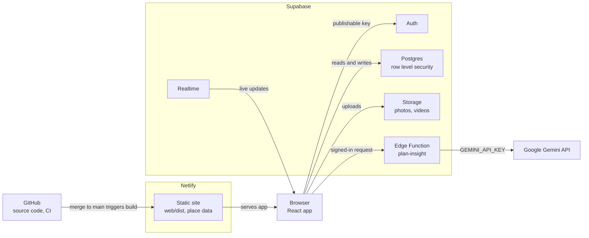

# made it out

Plan hangouts with friends without the group chat. A group posts a plan, members vote on times, and every outing they log grows the group's tree. Trying rare activities and deciding quickly earns points on local leaderboards.

| | |
|---|---|
| Live app | https://madeitout.netlify.app/ |
| Supabase dashboard (team members) | https://supabase.com/dashboard/project/vmvggjcyjfklirgfgyfu |

## Features

- **Accounts.** Sign up with email, username, phone and region; log in with any of the three. Verifying a university email adds a school leaderboard.
- **Friends and groups.** Add friends by username. Groups have 3 to 8 members; pairs compete on a separate Duos board. Each group's tree grows over its lifetime, with fruit for past outings and leaves for streaks.
- **Plans and voting.** Any member proposes one or more times, and everyone answers each one (yes, partly, if needed, no). The host confirms a time, or it confirms itself when voting closes.
- **Activity logs.** Place, date, attendees, description, photos and videos, labels, ratings and comments.
- **Scoring.** Rarity, turnout, decision speed, the First Bloom bonus and holidays, plus streaks and decay. See [docs/SCORING.md](docs/SCORING.md).
- **Boston data.** Real places from OpenStreetMap and City of Boston events, scored for rarity with Yelp and OpenStreetMap counts. See [docs/DATA.md](docs/DATA.md).
- **Cost estimates.** While a plan is typed, Gemini estimates the cost per person and adds a tag such as `#dinner`. If Gemini is unavailable, a built-in price list is used instead.

## Architecture



- **Browser to Supabase.** The app calls Supabase directly with the publishable key. Row level security in Postgres decides what each signed-in user can read or write, so the key is safe to ship to browsers.
- **Gemini.** Only the `plan-insight` Edge Function calls Gemini. Its key is a Supabase secret and never reaches the browser or this repository.
- **Netlify.** Builds `web/` from `main` on every merge, using [netlify.toml](netlify.toml), and serves the site plus the static place and event data.
- **GitHub Actions.** Runs lint, typecheck, tests, the production build and pipeline checks on every pull request.

| Layer | Technology |
|---|---|
| Frontend | React 19, TypeScript, Vite |
| Backend | Supabase: Postgres, Auth, Realtime, Storage, Edge Functions (Deno) |
| AI | Google Gemini, called from the Edge Function |
| Hosting and CI | Netlify, GitHub Actions |
| Data pipeline | Python 3 (OpenStreetMap, Yelp Open Dataset, City of Boston) |

See [docs/ARCHITECTURE.md](docs/ARCHITECTURE.md) for the data model and how saves and live updates work.

## Keys and configuration

No keys are stored in this repository.

| Value | Stored in | Notes |
|---|---|---|
| `VITE_SUPABASE_URL`, `VITE_SUPABASE_PUBLISHABLE_KEY` | Netlify environment variables; your own `web/.env.local` | Public by design. Read at build time, so redeploy after changing them in Netlify. |
| `GEMINI_API_KEY`, optional `GEMINI_MODEL` | Supabase: Edge Functions, Secrets | Changing it needs no code change or redeploy. |
| Supabase secret key | Not used | Never add it to env files, the repository or chat. It bypasses row level security. |

## Local development

Requires Node 22 and access to the Supabase project.

```bash
cd web
cp .env.example .env.local   # add the URL and publishable key from Project Settings > API
npm install
npm run dev                  # http://localhost:5173
```

Before opening a pull request, run the same checks as CI:

```bash
cd web && npm run lint && npm run typecheck && npm test && npm run build
cd pipeline && ruff check . && pytest
```

## Deployment

| Change | How it ships |
|---|---|
| App code (`web/`) | Merge into `main`. Netlify deploys to https://madeitout.netlify.app/; every pull request also gets a preview link. |
| Database (`supabase/migrations/`) | Add a new migration file, then run it once in the Supabase SQL Editor. Migrations run in filename order. |
| Edge Function (`supabase/functions/plan-insight/`) | Paste the updated file into Supabase under Edge Functions, `plan-insight`, and deploy. |

Supabase Auth URL settings (Authentication, URL Configuration): the Site URL is `https://madeitout.netlify.app`, and `http://localhost:5173` is listed under Redirect URLs for local development.

### Setting up a new Supabase project

1. Run every file in `supabase/migrations/` in the SQL Editor, oldest first.
2. Deploy `supabase/functions/plan-insight` as an Edge Function named `plan-insight`, then add the secret `GEMINI_API_KEY` (from https://aistudio.google.com/apikey).
3. Set the Auth URL settings above.
4. Put the new project URL and publishable key in Netlify and in `web/.env.local`.

## Repository layout

```
web/                  React app
  src/lib/            pure logic: scoring, plans and votes, budgets (unit tested)
  src/pages/          Auth, Profile, Group and Votes, Plan, Log, Leaderboard
  src/store.tsx       app state; saves to Supabase and applies live updates
  src/db.ts           Supabase reads and writes
  public/data/        places, events and rarity scores built by the pipeline
supabase/
  migrations/         schema, row level security, SQL functions
  functions/          Edge Functions (plan-insight)
pipeline/             Python: raw datasets to rarity scores and app data
data/                 raw and processed datasets (git-ignored)
docs/                 architecture, scoring, data sources
netlify.toml          Netlify build settings
```

## Data pipeline

Optional. It rebuilds `web/public/data/` from downloaded datasets; see [docs/DATA.md](docs/DATA.md).

```bash
cd pipeline
python3 -m pip install -e ".[dev]"
python3 -m made_it_out_pipeline.osm_places
python3 -m made_it_out_pipeline.app_data
```

## Contributing

Branch from `main`, use Conventional Commits, and open a pull request; CI must pass before merging. See [CONTRIBUTING.md](CONTRIBUTING.md).

Documentation: [Architecture](docs/ARCHITECTURE.md), [Scoring](docs/SCORING.md), [Data](docs/DATA.md), [Demo](docs/DEMO.md).
